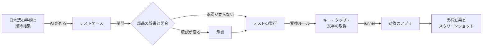

# 用語集（qata 固有の言葉）

qata 固有の言葉と、その意味です。文書・コード・画面では、ここの言葉を使います。契約の名前（英語）は `コード` で添えます。

- ここに載せるのは、qata の外では同じ意味で通じない言葉だけです。一般の言葉で言い換えられるなら、ここには足さずに、その言葉を使います。
- 一般の言葉で、言い方がいくつもあるものの推奨語は [general.md](general.md) にあります。

## 言葉のつながり

## テストケースまわり

| 言葉 | 意味 | 契約 |
| --- | --- | --- |
| 元の日本語 | テストケースの元になった、日本語の手順と期待結果。人が見比べるために残す | `instruction` |
| アクション | テストケースに書けるステップの種類。いまは、手順（キーを押す・タップする）と、期待結果（読んだ文字の完全一致、D17） | `type`（`press_key`・`tap`・`expect_text`） |
| 部品 | 画面の上の、操作したり読んだりするもの（ボタン・表示など）。名前で指す | `part` |
| 部品の辞書 | アプリごとの、部品の名前と、その部品に使えるアクションの一覧。名前を具体的な操作に変える仕組みでもある（D14） | `part-dictionary` |

## 確かめる・実行するまわり

| 言葉 | 意味 | 契約 |
| --- | --- | --- |
| 関門 | 通らないと先に進めない検査。テストケースでは、形式の検証と部品の辞書との照合。開発では、テストと検査 | `schema`・`unknown_part` など |
| 承認 | 実行の前に、人がテストケースを見て承認すること。要るかどうかはチェックボックスで選ぶ。状態は、不要・承認待ち・承認済みの三つ | `needs_review`、状態は `not_required`・`pending`・`approved` |
| 実行結果の状態 | テストケース全体は 通った・落ちた・エラー、ステップはそれに「飛ばした」が加わる | `passed`・`failed`・`error`・`skipped` |
| 変換ルール | server が、部品の名前をキー・座標・文字の取得方法などに変えるための規則。汎用の規則（キー、座標のタップ、UI Automation で読む）は server に置き、それ以外は内製のツールで足せるようにする（D14） | — |
| 文字の取得方法 | 画面の文字を取得する手段。いまは UI Automation だけ（D17） | `source.method`（`uia`） |
| スクリーンショットの範囲 | ウィンドウだけか、すべての画面をまとめて一枚か（D15） | `window`・`all_screens` |
| 復旧の手順 | テストが止まったあとの復旧（3 段で行う、[automation-pitfalls.md](../automation-pitfalls.md)）の最初の段で流す、状況に合った汎用の操作の並び（まだない） | — |

## 作り方まわり

| 言葉 | 意味 |
| --- | --- |
| 契約 | 部品の間でやり取りするデータの形。正は親の [contracts/](../../../contracts/) だけ |
| 親・子 | 親は判断と管理のリポジトリ（qata）。子は部品のリポジトリ（qata-server・qata-runner・qata-web） |
| idea | 次回以降の改善案。親の `docs/ideas.md` に置く。やると決めたものは issue にする（D11） |
| qata の範囲外 | 判断（テストの中身を考える、次にすることを決める、不具合を報告する）は、qata の範囲外の AI か人が行う（D39） |
| 切り出す道具 | qata の本体の外に、runner に頼らない独立したモジュールとして作る道具（設定・ログなど、D39） |

## この先増える種類

いまは最低限に絞っている。足すときは契約を変える（D14）。

| 種類 | いまあるもの | 増えそうなもの | 元になる知識 |
| --- | --- | --- | --- |
| 手順 | キーを押す・タップする | 修飾キーとの同時押し | [app-traits.md](../app-traits.md) の「同時押しを判定する」 |
| 期待結果 | 読んだ文字の完全一致 | — | — |
| 文字の取得方法 | UI Automation | 画像から読む（OCR）、古いアプリのウィンドウの文字 | [app-traits.md](../app-traits.md) の「古い Windows アプリ」 |
| スクリーンショットの範囲 | ウィンドウ・すべての画面 | — | [app-traits.md](../app-traits.md) の「全画面で、複数の画面にまたがる」 |
| 実行の前後 | 毎回起動し直す | 状態から復旧する | [automation-pitfalls.md](../automation-pitfalls.md) の「起動し直せない」 |
